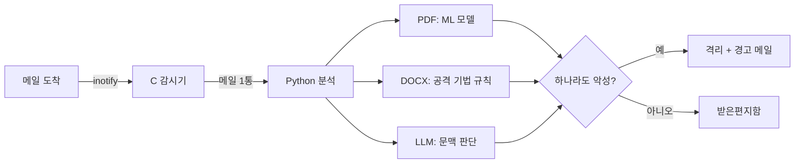

# A-Awake — 악성 이메일 탐지 시스템

메일 서버로 들어온 이메일을 **첨부파일 정적 분석**과 **LLM 문맥 분석** 두 갈래로 검사해, 악성으로 의심되면 사용자가 열기 전에 격리하고 경고 메일을 보내는 시스템입니다.

| | |
|---|---|
| **형태** | KISIA 교육과정 4인 팀 프로젝트 (2024) → 2026년 10월 개인 저장소로 옮겨 전면 정리 |
| **역할** | 팀장. 시스템 구조 설계, 핵심 코드 대부분 작성 |
| **기술** | C (inotify, GTK 3) · Python · scikit-learn · PyMuPDF / pdfid · OpenAI API · pytest · GitHub Actions |
| **핵심 아이디어** | 문서 구조의 위험 신호는 정적 분석으로, "제목·본문·첨부·링크가 서로 어울리는가"는 LLM으로 판단 |

## 어떻게 동작하나



- **PDF** — PyMuPDF·pdfid로 구조 피처(`/JS`, `/OpenAction` 등 28개)를 뽑아 RandomForest로 악성 확률 계산
- **DOCX** — 외부 템플릿 인젝션(T1221), 원격 OLE, DDE 필드, VBA 매크로 등 실제 공격 기법을 규칙으로 탐지
- **LLM** — 메일 내용을 '신뢰할 수 없는 데이터'로 감싸 피싱 정황 판단 (프롬프트 인젝션 완화)
- 판정 근거는 메일별 JSON으로 남고, GTK 화면에서 감시 시작/중지와 결과 목록을 볼 수 있음

## 결과

- PDF 모델: F1 0.879 ± 0.035, 균형 정확도 0.745 (반복 교차검증, [테스트 결과](docs/05-test-report.md#4-pdf-모델-평가))
- 자동 테스트 28개 통과, C 코드 `-Werror` 빌드 경고 0, CI로 푸시마다 검증
- 2026년 정리에서 **정확도 100%로 기록돼 있던 DOCX 모델이 데이터 누수였음을 밝히고** 규칙 기반으로 교체 ([설계 결정](docs/04-decisions.md#adr-01-docx-판정을-머신러닝에서-규칙-기반으로-바꾼다), [회고](docs/06-retrospective.md))

## 문서

| 문서 | 내용 |
|---|---|
| [01. 요구사항](docs/01-requirements.md) | 문제 정의, 범위, 기능·비기능 요구사항 |
| [02. 아키텍처](docs/02-architecture.md) | 구성 요소, 처리 순서, 판정 로직, 결과 데이터 형식 |
| [03. 기술 스택](docs/03-tech-stack.md) | 기술별 사용 위치와 선택 이유, 참고한 공격 기법, 데이터 |
| [04. 설계 결정](docs/04-decisions.md) | 주요 결정 7가지의 배경·대안·결과 (ADR) |
| [05. 테스트 결과](docs/05-test-report.md) | 자동 테스트, 빌드, 통합 시나리오, 모델 평가, 검증하지 못한 것 |
| [06. 회고](docs/06-retrospective.md) | 역할, 발견한 문제와 해결 과정, 배운 점, 개선 계획 |

## 빠른 실행

```bash
pip install -r requirements.txt
make                                   # build/awake_monitor, build/awake_gui (GUI는 libgtk-3-dev 필요)

export AWAKE_MAILDIR=~/Maildir         # 수신 폴더는 $AWAKE_MAILDIR/A-Awake
export OPENAI_API_KEY=...              # 선택. 없으면 LLM 단계는 건너뜀

scripts/run_monitor.sh                 # 서버: 감시기만
scripts/run_gui.sh                     # 데스크톱: GUI

PYTHONPATH=src python -m awake.pipeline 메일.eml --no-llm   # 메일 한 통만 분석 (파일은 그대로)
```

테스트: `pip install -r requirements-dev.txt && python -m pytest -q` · 모델 재학습: `python training/train_pdf.py`

## 변경 이력

- **2026-10 전면 정리** — 동작하지 않던 감시기 연결 수정, 셸 명령 주입 제거, 학습/추론 불일치 해결, DOCX 규칙 기반 전환, 테스트·CI·문서 추가 (자세한 내용은 [회고](docs/06-retrospective.md#2-2026년-정리에서-발견한-문제))
- **2026-10-02 1차 정리** — 커밋돼 있던 가상환경(약 13,000개 파일)·바이너리 제거, 하드코딩된 API 키 제거(노출된 키는 폐기 필요), OpenAI SDK 1.x로 교체
