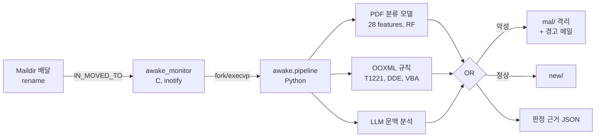

# A-Awake: 악성 이메일 탐지 시스템

Maildir 수신 폴더를 inotify로 감시하고, 수신 메일을 **첨부 정적 분석**(PDF 분류 모델, OOXML 공격 기법 규칙)과 **LLM 문맥 분석**으로 판정해 사용자 열람 전에 격리하는 메일 보안 파이프라인.

| 항목 | 내용 |
|---|---|
| 형태 | KISIA 교육과정 4인 팀 프로젝트 (2024), 2026년 10월 코드 감사 및 재구성 |
| 역할 | 팀장: 시스템 아키텍처 설계, 핵심 모듈 구현 주도 |
| 언어 | C11, Python 3.11+ |
| 주요 기술 | inotify, GTK 3, PyMuPDF, pdfid, scikit-learn, imbalanced-learn, OpenAI API, pytest, GitHub Actions |

## 아키텍처



| 엔진 | 방식 | 판정 기준 |
|---|---|---|
| PDF | PyMuPDF 메타데이터 7개 + pdfid 키워드 21개, `VarianceThreshold → SMOTE → RandomForest(300)` | $P(\text{malicious}) \ge 0.5$ |
| DOCX | `.rels` 외부 관계(`attachedTemplate`, `oleObject`, `frame`, `subDocument`), 필드 코드 DDE, `vbaProject.bin` | HIGH 탐지 ≥ 1 |
| LLM | 난수 구분자로 메일 격리, 최종 행 `VERDICT:` 문법 강제 | `MALICIOUS` |

## 주요 구현

- **이벤트 처리**: `IN_CLOSE_WRITE | IN_MOVED_TO`로 완결된 파일만 수신, `lstat` 기반 심볼릭 링크 배제, `execvp` 인자 전달로 셸 해석 제거
- **학습·추론 일관성**: 단일 피처 추출 모듈 공유, 전처리 포함 Pipeline 직렬화, 로드 시 피처 스키마 검증
- **입력 방어**: ZIP 항목 5,000개·XML 5 MiB·메일 30 MiB 상한, 첨부는 `mkstemp` 임시 경로로만 처리, 정규식 기반 OOXML 검사로 XXE 표면 제거
- **원자적 파일 연산**: 메일 이동은 `rename(2)`, 경고 메일은 임시 파일 기록 후 `os.replace`

## 결과

| 항목 | 값 |
|---|---|
| PDF 모델 (5-fold × 5 반복 CV) | F1 0.879 ± 0.035, ROC-AUC 0.846 ± 0.047, Balanced acc. 0.745 ± 0.061 |
| 테스트 | pytest 28개 통과, C `-Wall -Wextra -Werror` 경고 0 |
| 처리 시간 | 첨부 없음 390 ms, PDF 3.9 MB 포함 4.6 s (2 vCPU) |
| 코드 감사 | 결함 9건 식별·조치 (치명 1, 높음 4). 기존 DOCX 모델의 정확도 1.00이 데이터 누수에 의한 것임을 규명 |

## 문서

| 문서 | 내용 |
|---|---|
| [01. 요구사항 명세](docs/01-requirements.md) | 탐지 대상 위협, 범위, 기능 12개·비기능 11개 요구사항과 수용 기준 |
| [02. 아키텍처 설계](docs/02-architecture.md) | 구성 요소, 프로세스 모델, inotify 설정, CLI·환경변수·결과 스키마, 오류 처리 |
| [03. 탐지 엔진 명세](docs/03-detection-engines.md) | PDF 피처 정의·학습 파이프라인·피처 분석, DOCX 규칙, LLM 프롬프트·판정 문법 |
| [04. 기술 스택](docs/04-tech-stack.md) | 계층별 기술·버전, 선택 근거와 대안 비교, ATT&CK 매핑 |
| [05. 설계 결정 기록](docs/05-decisions.md) | ADR 7건 |
| [06. 테스트 결과](docs/06-test-report.md) | 단위·통합 시험, 모델 평가, 처리 성능, 미검증 항목 |
| [07. 코드 감사 및 개선 이력](docs/07-audit.md) | 결함 목록, 근본 원인, 조치, 잔여 리스크 |

## 실행

```bash
pip install -r requirements.txt
make                                   # build/awake_monitor, build/awake_gui (libgtk-3-dev 필요)

export AWAKE_MAILDIR=~/Maildir         # 감시 대상: $AWAKE_MAILDIR/A-Awake
export OPENAI_API_KEY=...              # 선택. 미설정 시 LLM 단계 생략

scripts/run_monitor.sh                 # 감시기
scripts/run_gui.sh                     # GUI

PYTHONPATH=src python -m awake.pipeline mail.eml --no-llm   # 단건 분석 (파일 이동 없음)
```

```bash
pip install -r requirements-dev.txt && python -m pytest -q   # 테스트
python training/train_pdf.py                                 # 모델 재학습
```

## 변경 이력

| 일자 | 내용 |
|---|---|
| 2026-10 | 코드 감사 및 재구성: 감시기·파이프라인 연결 복구, 셸 명령 주입 제거, 학습·추론 불일치 해소, DOCX 규칙 엔진 전환, 테스트·CI·문서화 ([상세](docs/07-audit.md)) |
| 2026-10-02 | 커밋된 가상환경(파일 약 13,000개)·바이너리 제거, 하드코딩된 API 키 제거, OpenAI SDK 1.x 마이그레이션 |
