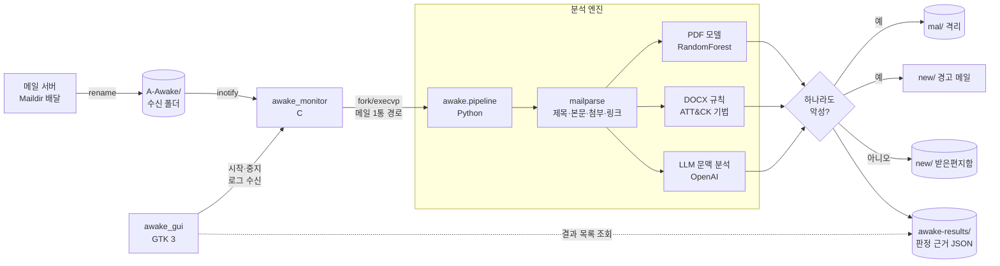
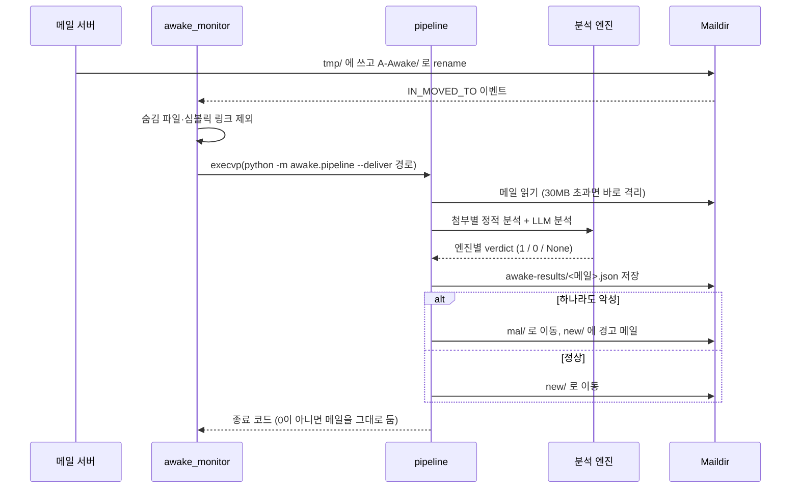

# 02. 아키텍처 설계

## 1. 전체 구조



## 2. 구성 요소

| 구성 요소 | 언어 | 책임 | 의존 |
|---|---|---|---|
| `awake_monitor` | C | 수신 폴더 감시, 새 메일마다 파이프라인 실행, 순차 처리 | Linux inotify |
| `awake_gui` | C | 감시기 실행/중지, 감시기 출력 표시, 결과 JSON 목록 표시 | GTK 3 |
| `awake.pipeline` | Python | 메일 1통 분석 → 판정 통합 → 이동·기록 | 아래 모듈 전부 |
| `awake.mailparse` | Python | MIME 파싱, 링크 추출, 첨부 본문 텍스트 추출 | email, BeautifulSoup, pdfplumber, python-docx, olefile |
| `awake.pdf_features` | Python | PDF 피처 추출 (**학습과 추론이 공유**) | PyMuPDF, pdfid |
| `awake.attachments` | Python | 첨부 확장자별로 엔진 선택, PDF 모델 로드·예측 | scikit-learn, imbalanced-learn |
| `awake.docx_rules` | Python | OOXML 정적 규칙 검사 | zipfile (표준 라이브러리) |
| `awake.llm` | Python | 프롬프트 구성, LLM 호출, 판정 파싱 | openai |
| `training/train_pdf.py` | Python | PDF 모델 학습·평가, 모델 카드 생성 | scikit-learn, imbalanced-learn |

C와 Python을 나눈 이유는 [04-decisions.md](04-decisions.md)의 ADR-03에 적었다.

## 3. 메일 한 통의 처리 순서



## 4. 판정 로직

각 엔진은 `verdict`를 `1`(악성), `0`(정상), `None`(판정 불가: 오류·미지원·생략) 중 하나로 낸다. 최종 판정은 **하나라도 1이면 악성**이고, `None`은 판정에서 빠지되 이유가 결과 JSON에 남는다.

| 엔진 | 악성 조건 | 판정 불가가 되는 경우 |
|---|---|---|
| PDF 모델 | 악성 확률 ≥ 0.5 | PDF가 아님, pdfid 분석 실패 |
| DOCX 규칙 | HIGH 등급 항목이 1개 이상 | (항상 판정함. MEDIUM만 있으면 0) |
| LLM | 응답 마지막 줄이 `VERDICT: MALICIOUS` | 첨부·링크 없음, API 키 없음, 호출 실패, 형식 위반 |

"하나라도 악성이면 격리"는 놓치는 것(미탐)보다 잘못 격리하는 것(오탐)이 덜 위험하다는 판단이다. 격리된 메일은 지워지지 않고 `mal/`에 남으므로 사용자가 꺼낼 수 있다.

## 5. 데이터 형식

판정 결과 JSON (`awake-results/<메일 파일명>.json`). 외부 템플릿 인젝션을 넣은 테스트 메일을 감시기로 처리했을 때의 실제 출력이다.

```json
{
  "subject": "evil 메일",
  "from": "a@b.c",
  "links": [],
  "attachments": [
    {
      "filename": "invoice.docx", "size": 18776, "engine": "docx_rules", "status": "ok", "verdict": 1,
      "findings": [{"level": "high", "rule": "template_injection",
                    "detail": "word/_rels/settings.xml.rels: attachedTemplate → http://203.0.113.9/tpl.dotm"}]
    }
  ],
  "llm": {"status": "skipped", "verdict": null, "analysis": "OPENAI_API_KEY가 없어 LLM 분석을 생략했습니다."},
  "final_decision": "malicious",
  "reasons": ["첨부 invoice.docx: 악성 문서 기법 탐지 (template_injection)"],
  "email_file": "1001.evil:2,"
}
```

## 6. 폴더 구조

```
src/
  monitor/awake_monitor.c     감시기
  gui/awake_gui.c             GUI
  awake/                      분석 패키지 (pipeline, mailparse, pdf_features, attachments, docx_rules, llm, config)
  awake/vendor/pdfid.py       Didier Stevens의 pdfid (퍼블릭 도메인)
models/                       학습된 PDF 모델 + 모델 카드
training/                     학습 스크립트, 데이터, 당시 노트북(기록용)
tests/                        pytest 테스트, 샘플 PDF·DOCX
scripts/                      실행 스크립트 (환경변수 설정 포함)
docs/                         이 문서들
```
