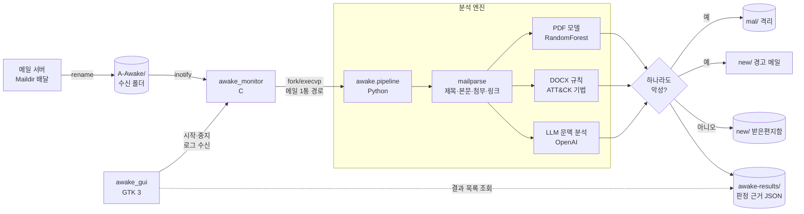
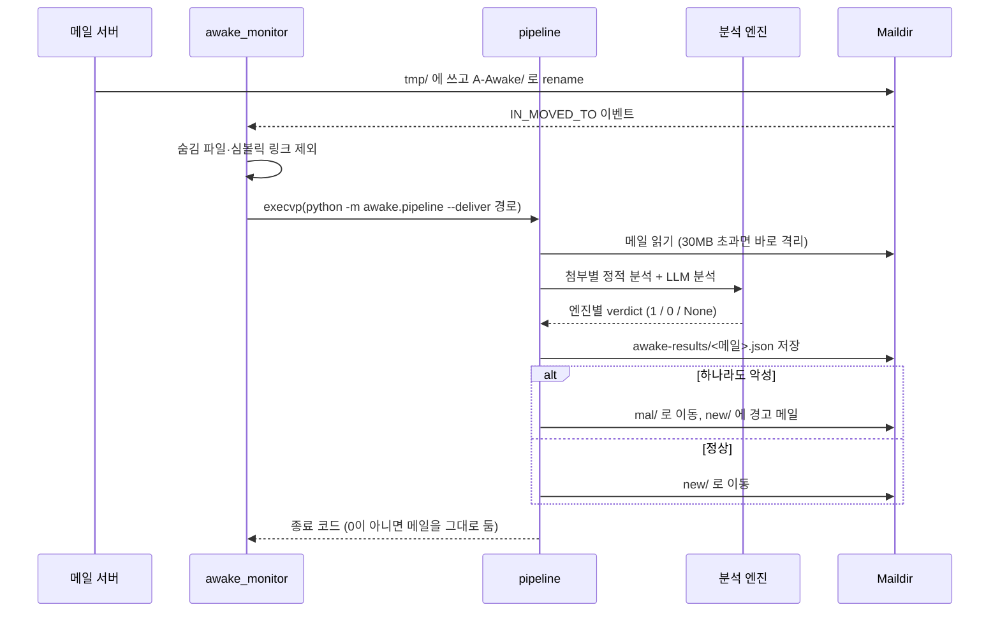

# 02. 아키텍처 설계

## 1. 시스템 구성



| 구성 요소 | 언어 | 프로세스 | 책임 |
|---|---|---|---|
| `awake_monitor` | C11 | 상주 | inotify 이벤트 수신, 메일 단위 파이프라인 실행, 순차 처리 |
| `awake_gui` | C11, GTK 3 | 상주 (선택) | 감시기 생명주기 관리, 출력 스트림 표시, 결과 조회 |
| `awake.pipeline` | Python | 메일당 1회 | 파싱, 엔진 호출, 판정 통합, 파일 이동, 결과 기록 |
| `awake.mailparse` | Python | 라이브러리 | MIME 트리 순회, 본문·첨부·URL 추출, 첨부 텍스트 추출 |
| `awake.pdf_features` | Python | 라이브러리 | PDF 피처 추출 (학습·추론 공용) |
| `awake.attachments` | Python | 라이브러리 | 확장자 기반 엔진 분기, 모델 로드(프로세스 내 캐시) |
| `awake.docx_rules` | Python | 라이브러리 | OOXML 패키지 정적 검사 |
| `awake.llm` | Python | 라이브러리 | 프롬프트 구성, API 호출, 판정 파싱 |

## 2. 프로세스 모델

### 2.1 메일 처리 시퀀스



### 2.2 이벤트 감지

| 항목 | 설정 | 근거 |
|---|---|---|
| 감시 마스크 | `IN_CLOSE_WRITE \| IN_MOVED_TO` | `IN_CREATE`는 기록 완료 전에 발생해 부분 파일을 읽을 수 있음. Maildir 배달은 `rename(2)`이므로 `IN_MOVED_TO`로 완결된 파일만 수신 |
| 디스크립터 | `inotify_init1(IN_CLOEXEC)` | 자식 프로세스로 inotify fd 누수 방지 |
| 버퍼 | `64 × (sizeof(struct inotify_event) + NAME_MAX + 1)` | 1회 `read(2)`로 최대 64개 이벤트 수용 |
| 필터 | `.` 시작 이름, `/` 포함 이름, `IN_ISDIR`, 비정규 파일(`lstat` 기준) 제외 | 임시 파일·심볼릭 링크 경유 접근 차단 |
| 시그널 | `SIGTERM`, `SIGINT` 핸들러(`SA_RESTART` 미설정) | 블로킹 `read(2)`가 `EINTR`로 반환되어 종료 플래그 확인 |

### 2.3 실행 및 동시성

- 감시기는 메일마다 `fork(2)` 후 `execvp(3)`로 `python -m awake.pipeline --deliver <경로>`를 실행하고 `waitpid(2)`로 완료를 기다린다. 셸을 거치지 않으므로 파일명은 argv 원소로만 전달된다.
- 처리는 **직렬**이다. 처리 중 발생한 이벤트는 커널 inotify 큐에 적재되며 다음 `read(2)`에서 소비된다. 동일 파일에 대한 동시 처리가 구조적으로 발생하지 않는다.
- 결과는 종료 코드로만 전달된다. `0`이 아니면 감시기는 메일을 이동하지 않고 로그만 남긴다.

### 2.4 파일 시스템 연산

| 연산 | 방식 | 목적 |
|---|---|---|
| 메일 이동 | `shutil.move` (동일 파일 시스템에서 `rename(2)`) | 원자적 이동 |
| 경고 메일 생성 | `awake-results/.<uuid>.tmp`에 기록 후 `os.replace`로 `new/` 이동 | 부분 기록된 메일이 MUA에 노출되지 않도록 함 |
| 경고 메일 파일명 | `<epoch>.<uuid4>.<hostname>` | Maildir 고유 이름 규칙 |
| 첨부 분석 | `tempfile.mkstemp(prefix="awake-")` 후 즉시 삭제 | 공격자가 지정한 원본 파일명을 경로로 사용하지 않음 |

## 3. 인터페이스 명세

### 3.1 CLI

```
python -m awake.pipeline [--deliver] [--no-llm] <mail>
```

| 옵션 | 동작 |
|---|---|
| (없음) | 분석 결과 JSON을 stdout으로 출력. 파일 시스템 변경 없음 |
| `--deliver` | 결과 JSON 저장, 판정에 따라 메일 이동, 격리 시 경고 메일 생성 |
| `--no-llm` | LLM 단계 생략 (`llm.status = "skipped"`) |

| 종료 코드 | 의미 |
|---|---|
| `0` | 분석 완료 |
| `1` | 처리되지 않은 예외 (Python 기본) |
| `2` | 인자로 받은 경로가 정규 파일이 아님 |

```
awake_monitor <watch_dir>
awake_gui <watch_dir> <result_dir>
```

### 3.2 환경변수

| 변수 | 기본값 | 용도 |
|---|---|---|
| `AWAKE_MAILDIR` | `~/Maildir` | Maildir 루트. 하위 `A-Awake/`, `new/`, `mal/`, `awake-results/` 사용 |
| `AWAKE_MODEL_DIR` | `<repo>/models` | PDF 모델 위치 |
| `AWAKE_LLM_MODEL` | `gpt-4o-mini` | LLM 모델명 |
| `OPENAI_API_KEY` | (없음) | 미설정 시 LLM 단계 생략 |
| `AWAKE_PYTHON` | `python3` | 감시기가 실행할 인터프리터 |
| `PYTHONPATH` | `scripts/env.sh`가 `<repo>/src` 설정 | `awake` 패키지 경로 |

### 3.3 결과 스키마 (`awake-results/<메일명>.json`)

| 필드 | 타입 | 설명 |
|---|---|---|
| `subject`, `from` | string | 디코딩된 헤더 값 |
| `links` | string[] | 중복 제거된 URL, 출현 순서 유지 |
| `attachments[]` | object[] | 첨부별 분석 결과 (아래) |
| `attachments[].engine` | `"pdf_ml"` \| `"docx_rules"` \| null | 적용 엔진 |
| `attachments[].status` | `"ok"` \| `"error"` \| `"unsupported"` | 분석 상태 |
| `attachments[].verdict` | 1 \| 0 \| null | 엔진 판정 |
| `attachments[].malicious_probability` | number | PDF 전용, 0~1 |
| `attachments[].features` | object | PDF 전용, 28개 피처 값 |
| `attachments[].findings[]` | `{level, rule, detail}` | DOCX 전용 |
| `llm` | `{status, verdict, analysis}` | `status`: `ok` \| `skipped` \| `error` |
| `final_decision` | `"malicious"` \| `"normal"` | 최종 판정 |
| `reasons` | string[] | 악성 판정 근거 요약 |
| `email_file` | string | Maildir 파일명 |

실제 출력 예 (외부 템플릿 인젝션 DOCX 첨부 메일, `llm` 생략):

```json
{
  "subject": "evil 메일",
  "from": "a@b.c",
  "links": [],
  "attachments": [
    {
      "filename": "invoice.docx", "size": 18776, "engine": "docx_rules", "status": "ok", "verdict": 1,
      "findings": [{"level": "high", "rule": "template_injection",
                    "detail": "word/_rels/settings.xml.rels: attachedTemplate → http://203.0.113.9/tpl.dotm"}]
    }
  ],
  "llm": {"status": "skipped", "verdict": null, "analysis": "OPENAI_API_KEY가 없어 LLM 분석을 생략했습니다."},
  "final_decision": "malicious",
  "reasons": ["첨부 invoice.docx: 악성 문서 기법 탐지 (template_injection)"],
  "email_file": "1001.evil:2,"
}
```

## 4. 판정 통합

엔진 판정 집합을 $V = \{v_i\}$, $v_i \in \{1, 0, \text{None}\}$이라 할 때 최종 판정은 $\exists v_i = 1$이면 악성이다. `None`은 집계에서 제외하고 사유를 결과에 남긴다.

| 엔진 | 악성 조건 | `None` 조건 |
|---|---|---|
| PDF 모델 | $P(\text{malicious}) \ge 0.5$ | PyMuPDF 열기 실패, pdfid `IsPDF ≠ True` |
| DOCX 규칙 | HIGH 등급 탐지 ≥ 1 | 없음 (항상 판정) |
| LLM | 응답 최종 행이 `VERDICT: MALICIOUS` | 첨부·링크 없음, API 키 없음, 호출 예외, 최종 행 형식 불일치 |

논리합 정책은 미탐 비용이 오탐 비용보다 크다는 전제를 따른다. 격리는 삭제가 아니므로 복구 가능하다. 정책 근거는 [05-decisions.md](05-decisions.md) ADR-06.

## 5. 오류 처리

| 상황 | 처리 | 메일 상태 |
|---|---|---|
| 메일 크기 > 30 MiB | 분석 생략, `malicious`로 격리 | `mal/` |
| PDF 파싱 실패 | 해당 첨부 `status: error`, 나머지 계속 | 다른 엔진 판정에 따름 |
| 지원하지 않는 첨부 형식 | `status: unsupported` | 다른 엔진 판정에 따름 |
| LLM 호출 예외 | `llm.status: error`, 예외 클래스명만 기록 | 다른 엔진 판정에 따름 |
| 모델 피처 목록 불일치 | `RuntimeError`로 파이프라인 중단 | 이동하지 않음 |
| 파이프라인 비정상 종료 | 감시기가 stderr에 기록 | 수신 폴더에 유지 |
| 감시 중 파일이 사라짐 | `lstat` 실패 시 무시 | 해당 없음 |

## 6. 저장소 구조

```
src/
  monitor/awake_monitor.c     감시기
  gui/awake_gui.c             GUI
  awake/                      분석 패키지
    pipeline.py               진입점, 판정 통합, 파일 이동
    mailparse.py              MIME 파싱, 텍스트 추출
    pdf_features.py           PDF 피처 추출 (학습·추론 공용)
    attachments.py            엔진 분기, 모델 로드
    docx_rules.py             OOXML 규칙 검사
    llm.py                    LLM 분석
    config.py                 경로·상한값
    vendor/pdfid.py           pdfid 0.2.8 (Didier Stevens, 퍼블릭 도메인)
models/                       pdf_model.joblib, pdf_model_card.json
training/                     train_pdf.py, data/, notebooks_legacy/
tests/                        pytest, fixtures/
scripts/                      env.sh, run_monitor.sh, run_gui.sh
.github/workflows/ci.yml      CI
```
